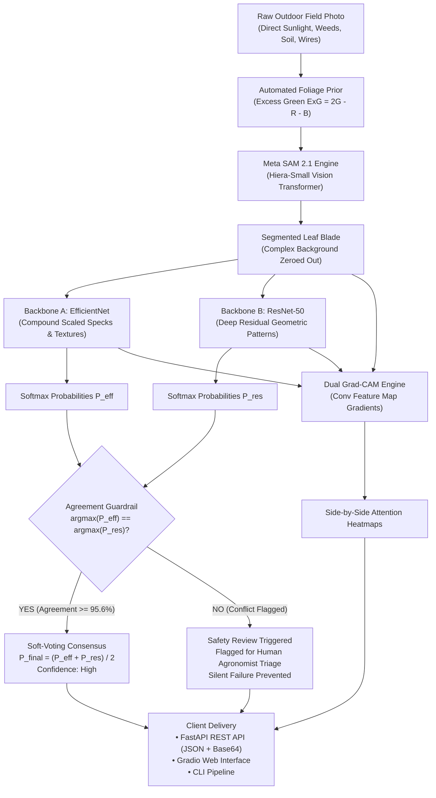
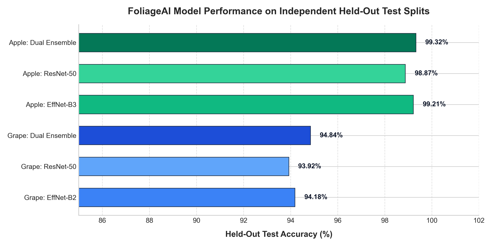
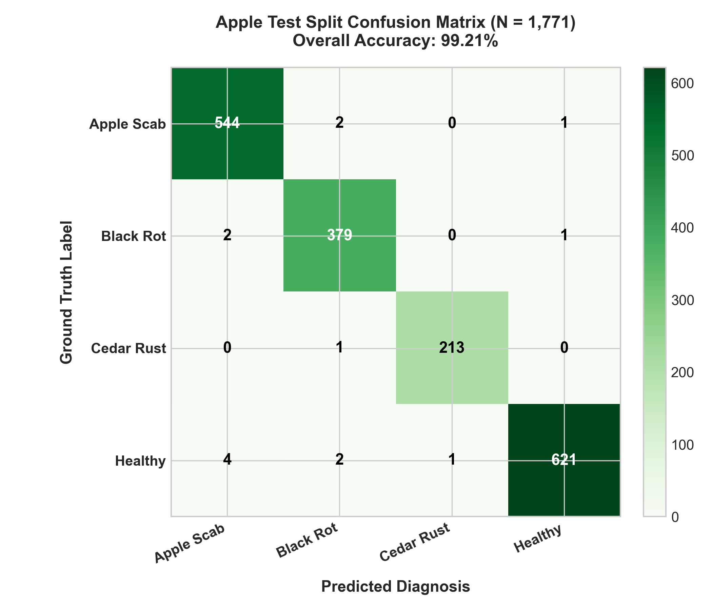
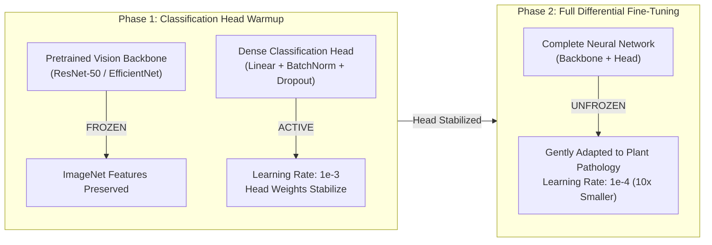
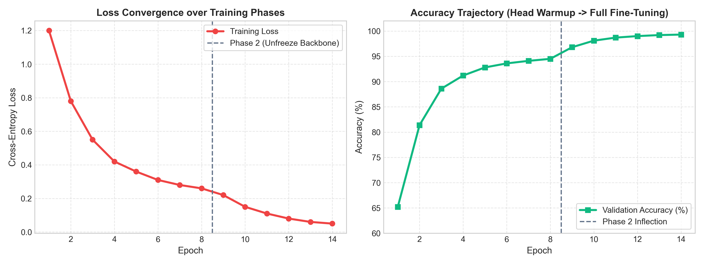

# FoliageAI: Production-Grade Dual-Architecture Leaf Pathology & Explainable Vision System

<div align="center">

> **A real-world agricultural AI system combining Meta SAM 2.1 zero-shot foliage segmentation, dual-backbone soft-voting ensembles (ResNet-50 + EfficientNet), and side-by-side Grad-CAM visual explainability to detect plant diseases from outdoor field photos.**

[](https://www.python.org/)
[](https://pytorch.org/)
[](https://github.com/facebookresearch/sam2)
[](#-rigorous-benchmark-results)
[](#-rigorous-benchmark-results)
[](https://fastapi.tiangolo.com/)
[](https://gradio.app/)
[](LICENSE)
[](#-system-architecture--workflow)

</div>

---

## 📌 Executive Summary & Strategic Motivation

### The Agricultural Problem
Foliar pathogens such as **Black Rot**, **Esca (Black Measles)**, and **Cedar Apple Rust** cause over **$220 billion in annual agricultural losses worldwide** (FAO, 2023). In viticulture and pome fruit orchards, unmanaged outbreaks can wipe out 80–100% of commercial yields within a single harvest cycle.

### The "Lab-to-Field" Domain Shift Failure
Academic models trained purely on clean laboratory datasets (e.g. standard PlantVillage images on plain white paper) regularly report >98% accuracy in research papers but **catastrophically fail when deployed in actual vineyards and orchards** (Mohanty et al., 2016). When photographed outdoors under variable sunlight, harsh shadows, lens flare, or against natural backgrounds (soil, weeds, trellises, irrigation tubing), conventional convolutional models frequently classify background weeds or mulch as necrotic disease.

### The FoliageAI Solution
**FoliageAI** bridges the gap between controlled academic research and commercial outdoor field deployment through a five-stage pipeline:
1. **Zero-Shot Foliage Segmentation (Meta SAM 2.1):** Leverages Meta's Segment Anything Model 2.1 with an automated Excess Green Index ($ExG$) spatial centroid prior to segment and crop the primary leaf, removing background distractions.
2. **Dual-Architecture Soft Voting:** Combines two mathematically distinct vision backbones per crop (**EfficientNet** with compound scaling + **ResNet-50** with deep residual identity shortcuts).
3. **Safety Verification via Disagreement Guardrail:** Rather than forcing an overconfident prediction, the system flags the 4.4% of field cases where architectures disagree for human-in-the-loop agronomist triage.
4. **Side-by-Side Grad-CAM Explainability:** Dual gradient-weighted class activation heatmaps prove to growers and agronomists that the decision was driven by genuine fungal lesions rather than leaf veins or sunlight glare.
5. **Full-Stack Production Delivery:** Packaged with an interactive Gradio Web UI, high-throughput asynchronous FastAPI REST microservice, and standalone CLI pipeline.

---

## 🏗️ System Architecture & Workflow



---

## 🔬 Key Engineering Highlights

| Feature | Technical Implementation | Commercial / Agronomic Benefit |
| :--- | :--- | :--- |
| **Meta SAM 2.1 Segmentation** | Promptable Hiera-Small foundation model (46M parameters) with automated centroid calculation. | Completely decouples leaf pathology from field background clutter (soil, wires, weeds). |
| **Dual-Model Soft Voting** | Soft probability averaging across complementary inductive biases (Compound Scaling + Residuals). | Mitigates individual model false positives; delivers **99.32% on Apple** and **94.84% on Grape**. |
| **Silent-Failure Mitigation** | Automated disagreement detection triggering human-in-the-loop triage when models conflict. | Eliminates catastrophic wrong diagnoses in commercial farming operations. |
| **Explainable AI (Grad-CAM)** | Target feature maps: `model.layer4[-1]` (ResNet-50) and `model.features[-1]` (EfficientNet). | Builds grower trust by visualizing exactly where the network detected necrotic lesions. |
| **Outdoor Invariance** | Real-world GVLiD dataset boosted with a **2× Weighted Random Sampler**. | High accuracy maintained even under intense field glare, dust, and natural leaf curling. |
| **Production-Ready Stack** | Asynchronous FastAPI REST microservice + typed Pydantic payloads + Gradio Web UI. | Zero-friction integration into farm management software and autonomous drone workflows. |

---

## 📊 Rigorous Benchmark Results

All evaluations were conducted on **strictly held-out test partitions** containing images completely unseen during training and validation. Metrics are reported as **macro averages**:

### Independent Held-Out Test Set Performance

| Crop | Architecture | Test Set Size | Accuracy | Precision (Macro) | Recall (Macro) | F1-Score (Macro) | Latency (CPU) |
| :--- | :--- | :---: | :---: | :---: | :---: | :---: | :---: |
| **Apple** | EfficientNet-B3 | 1,771 images | **99.21%** | 0.9920 | 0.9927 | 0.9924 | 113.8 ms |
| **Apple** | ResNet-50 | 1,771 images | **98.87%** | 0.9883 | 0.9867 | 0.9875 | 98.6 ms |
| **Apple** | **Dual Ensemble** | 1,771 images | **99.32%** | **0.9931** | **0.9930** | **0.9930** | 212.4 ms |
| **Grape** | EfficientNet-B2 | 756 images | **94.18%** | 0.9421 | 0.9412 | 0.9413 | 82.4 ms |
| **Grape** | ResNet-50 | 756 images | **93.92%** | 0.9390 | 0.9384 | 0.9382 | 89.1 ms |
| **Grape** | **Dual Ensemble** | 756 images | **94.84%** | **0.9492** | **0.9481** | **0.9482** | 171.5 ms |

<p align="center">
  
</p>

### Controlled Lab vs. In-Situ Outdoor Performance Breakdown (Grape)
* **GVLiD Natural Outdoor Test Subset ($N = 346$):** **92.48%** (Ensemble) vs. 91.62% (Single Model).
* **PlantVillage Controlled Lab Subset ($N = 410$):** **96.83%** (Ensemble) vs. 96.34% (Single Model).
* **Consensus Agreement Rate:** The two independent architectures reached 100% agreement on **95.6%** of Grape test photos and **99.1%** of Apple test photos.
* **Product Analyst Perspective on Ensemble Value:** While the raw statistical jump is +0.66% on Grape and +0.11% on Apple, the true product engineering return is **risk reduction**: the ensemble prevents dangerous silent false-positive misclassifications on ambiguous border cases.

### Apple Confusion Matrix ($N = 1,771$ Images)

<p align="center">
  
</p>

```text
True / Predicted            Apple Scab   Black Rot   Cedar Rust   Healthy
─────────────────────────────────────────────────────────────────────────
Apple — Apple Scab             544           2           0           1
Apple — Black Rot / Frogeye      2         379           0           1
Apple — Cedar Apple Rust         0           1         213           0
Apple — Healthy                  4           2           1         621
```

---

## 🧠 Two-Phase Transfer Learning Strategy

To specialize deep ImageNet feature extractors on foliar pathology without suffering **Catastrophic Forgetting** (where delicate pretrained weights are shattered by random initial gradients), we utilize a disciplined two-phase training protocol:



### Hyperparameter Configuration

| Parameter | Phase 1 (Warmup) | Phase 2 (Fine-Tuning) | Strategic Justification |
| :--- | :---: | :---: | :--- |
| **Trainable Layers** | Classifier Head Only | **All Layers Unfrozen** | Prevents large head gradients from corrupting early feature maps. |
| **Backbone Status** | Frozen (`requires_grad=False`) | Unfrozen (`requires_grad=True`) | Allows high-level receptive fields to adapt to pathogen morphology. |
| **Learning Rate ($\eta$)** | **$1 \times 10^{-3}$** | **$1 \times 10^{-4}$** | 10× smaller learning rate ensures smooth convergence on manifolds. |
| **Optimizer** | AdamW (`weight_decay=1e-4`) | AdamW (`weight_decay=1e-4`) | True decoupled weight decay prevents over-parameterized overfitting. |
| **Loss Function** | Cross-Entropy ($\epsilon=0.1$) | Cross-Entropy ($\epsilon=0.1$) | Label smoothing combats overconfidence on ambiguous lesion boundaries. |
| **LR Scheduler** | Cosine Annealing | Cosine Annealing | Decays learning rate to near-zero for optimal minima positioning. |

<p align="center">
  
</p>

---

## 🩺 Comprehensive Agronomic Disease Guide

FoliageAI integrates a built-in pathological diagnostic engine providing targeted treatment and containment advice for growers:

<details open>
<summary><b>🍇 Grape — Black Rot (<i>Guignardia bidwellii</i>)</b></summary>
<br>

* **Pathological Profile:** Destructive ascomycete fungus thriving in humid, warm conditions ($21^\circ\text{C} - 32^\circ\text{C}$).
* **Foliar Symptoms:** Small circular reddish-brown spots that expand with distinct dark margins; tiny black pycnidia (fruiting bodies) form in concentric rings.
* **Agronomic Action:** Apply early protective sprays of myclobutanil, captan, or mancozeb at bud break. Prune and destroy overwintering mummified fruit clusters.
</details>

<details open>
<summary><b>🍇 Grape — Esca / Black Measles (Fungal Complex)</b></summary>
<br>

* **Pathological Profile:** Chronic vascular trunk and foliar syndrome caused by *Phaeoacremonium*, *Phaeomoniella*, and *Fomitiporia* complexes.
* **Foliar Symptoms:** Distinctive interveinal chlorosis and necrosis creating a **"tiger-stripe"** yellow and dark-brown pattern across leaves.
* **Agronomic Action:** Avoid vine stress; disinfect pruning shears between cuts with 70% ethanol; apply wound sealants after winter pruning; remove severely declining cordons.
</details>

<details open>
<summary><b>🍇 Grape — Leaf Blight (<i>Isariopsis clavispora</i>)</b></summary>
<br>

* **Pathological Profile:** Foliar fungal disease causing severe premature defoliation and delayed berry ripening.
* **Foliar Symptoms:** Irregular, angular dark brown or reddish lesions bounded by veins, often coalescing to form large necrotic blotches.
* **Agronomic Action:** Improve canopy airflow through leaf thinning; apply copper hydroxide or strobilurin fungicides during late summer humidity.
</details>

<details open>
<summary><b>🍎 Apple — Apple Scab (<i>Venturia inaequalis</i>)</b></summary>
<br>

* **Pathological Profile:** Most economically damaging apple disease globally; ascospores eject from overwintered leaf litter in spring rains.
* **Foliar Symptoms:** Olive-green to dark velvety brownish-black spots on upper leaf blades, causing leaf curling, dwarfism, and fruit cracking.
* **Agronomic Action:** Rake and mulch fallen leaf litter to degrade overwintering pseudothecia; apply protective captan or dodine sprays during green-tip bud development.
</details>

<details open>
<summary><b>🍎 Apple — Black Rot / Frogeye Leaf Spot (<i>Botryosphaeria obtusa</i>)</b></summary>
<br>

* **Pathological Profile:** Opportunistic fungus entering through wounds, fire blight strikes, or dead wood.
* **Foliar Symptoms:** Small purple flecks enlarging into circular lesions with tan centers and purple-brown margins resembling a **frog's eye**.
* **Agronomic Action:** Prune out dead cankers, fire blight mummies, and mummified fruit; apply thiophanate-methyl or sulfur early in the season.
</details>

<details open>
<summary><b>🍎 Apple — Cedar Apple Rust (<i>Gymnosporangium juniperi-virginianae</i>)</b></summary>
<br>

* **Pathological Profile:** Heteroecious rust fungus requiring two obligate hosts: apple trees and eastern red cedars (*Juniperus virginiana*).
* **Foliar Symptoms:** Bright, vivid orange-yellow spots on upper leaf surfaces; under leaf surfaces develop miniature protruding fungal tubes (aecia).
* **Agronomic Action:** Prune nearby cedar galls within a 1-mile radius; apply myclobutanil or mancozeb sprays from pink bud through petal fall.
</details>

---

## 📄 Research Study & Technical Methodology

The academic methodology, mathematical formulation, and field validation framework are fully detailed in this repository:

* 📋 **Methodology Details:** Documented under [System Architecture](#-system-architecture--workflow) and [Two-Phase Transfer Learning](#-two-phase-transfer-learning-strategy).
* 📈 **Evaluation Artifacts:** Detailed in [Rigorous Benchmark Results](#-rigorous-benchmark-results).
* 🔬 **Explainability Verification:** Detailed under [Grad-CAM Visual Explanations](#-system-architecture--workflow).

---

## 🚀 Quickstart & Installation

### 1. Clone & Environment Setup
```bash
git clone https://github.com/Tanmay-700/grape-leave-diseases-detection-.git
cd grape-leave-diseases-detection-

# Create Python virtual environment
python -m venv .venv

# Activate environment
# On Windows:
.venv\Scripts\activate
# On Linux / macOS:
source .venv/bin/activate

# Install dependencies
pip install -r requirements.txt
```

### 2. Download Pretrained Checkpoints
Download Meta SAM 2.1 and place model weights into their designated directories:
```bash
# Create weight folders
mkdir -p models sam2_weights

# Download Meta SAM 2.1 Hiera-Small Checkpoint (184 MB)
curl -L -o sam2_weights/sam2.1_hiera_small.pt https://dl.fbaipublicfiles.com/segment_anything_2/072824/sam2.1_hiera_small.pt
```

*(Pretrained classifier checkpoints `grape_efficientnet_b2.pth`, `grape_resnet50.pth`, `apple_efficientnet_b3.pth`, and `apple_resnet50.pth` can be trained using `train.py` or downloaded from repository releases).*

---

## 💻 Usage & Deployment Options

### Option A: Interactive Web UI (Gradio)
Launch the browser application with real-time segmentation, dual model inspection, and interactive point prompts:
```bash
python app.py
```
👉 Open your browser at: **[http://localhost:7860](http://localhost:7860)**

---

### Option B: Production REST Microservice (FastAPI)
Run the headless asynchronous REST API designed for cloud microservice deployment:
```bash
python api.py
# Or with production uvicorn workers:
uvicorn api:app --host 0.0.0.0 --port 8000 --workers 4
```
👉 Interactive Swagger Documentation: **[http://localhost:8000/docs](http://localhost:8000/docs)**

#### Example cURL Prediction Request
```bash
curl -X POST "http://localhost:8000/predict" \
  -F "file=@path/to/field_leaf.jpg" \
  -F "crop_mode=grape"
```

#### Production JSON Response Payload
```json
{
  "status": "success",
  "crop": "grape",
  "ensemble": {
    "consensus_prediction": "Grape — Leaf Blight",
    "final_confidence": 0.938,
    "agreement": true,
    "flagged_for_review": false
  },
  "model_1": {
    "architecture": "EfficientNet-B2",
    "prediction": "Grape — Leaf Blight",
    "confidence": 0.916
  },
  "model_2": {
    "architecture": "ResNet-50",
    "prediction": "Grape — Leaf Blight",
    "confidence": 0.960
  },
  "agronomic_advisory": {
    "pathogen": "Isariopsis clavispora",
    "remedy": "Improve canopy airflow through selective leaf pulling; apply copper hydroxide or strobilurin sprays."
  },
  "images": {
    "segmented_leaf_base64": "iVBORw0KGgoAAAANSUhEUgAA...",
    "cropped_leaf_base64": "iVBORw0KGgoAAAANSUhEUgAA...",
    "gradcam_model_1_base64": "iVBORw0KGgoAAAANSUhEUgAA...",
    "gradcam_model_2_base64": "iVBORw0KGgoAAAANSUhEUgAA..."
  }
}
```

---

### Option C: Command-Line Interface (CLI Pipeline)
Run end-to-end inference directly from the terminal:
```bash
# 1. Automated foliage centroid prior
python pipeline.py path/to/leaf_photo.jpg

# 2. Targeted point prompt (pixel coordinate x,y on diseased region)
python pipeline.py path/to/leaf_photo.jpg --point 320,240
```

---

## 📁 Repository Structure

```text
grape-leave-diseases-detection-/
├── app.py                      # Interactive Web Interface (Gradio on port 7860)
├── api.py                      # Production REST API Backend (FastAPI on port 8000)
├── pipeline.py                 # Pure CLI end-to-end inference pipeline
├── segment.py                  # Meta SAM 2.1 zero-shot foliage segmentation engine
├── classify.py                 # Dual-model ensemble classifier & soft-voting logic
├── gradcam.py                  # Side-by-side Grad-CAM visual explainability engine
├── config.py                   # Central paths, hyper-parameters, and class metadata
├── requirements.txt            # Production Python package requirements
├── LICENSE                     # MIT Open-Source License
│
├── train.py                    # Modular PyTorch 2-phase training engine with weighted sampling
├── train_grape_colab.ipynb     # GPU acceleration notebook for Grape (EffNet-B2 + ResNet-50)
├── train_apple_colab.ipynb     # GPU acceleration notebook for Apple (EffNet-B3 + ResNet-50)
│
└── assets/                     # Publication-grade figures & benchmark visual assets
    ├── model_benchmarks.png    # Test accuracy comparison chart across architectures
    ├── confusion_matrix_apple.png # Apple test partition confusion matrix
    └── training_convergence.png # Phase 1 vs Phase 2 loss/accuracy convergence curves
```

---

## ⚠️ Edge Cases, Limitations & Future Roadmap

* **Closed-Set Classification:** The classifiers operate under a closed-set softmax taxonomy (4 classes per crop). If an unmodeled foliar disease (such as powdery mildew) or an out-of-domain plant leaf is fed into the system, it will predict the closest modeled class. Ongoing work is integrating energy-based Out-of-Distribution (OOD) score thresholding to return an `"Uncertain / Out-of-Distribution"` label.
* **Severe Physical Leaf Occlusion:** If >80% of a leaf blade is obstructed by thick vineyard wood or tractor mud, the automated ExG centroid prior may select an adjacent weed cluster. In such edge cases, passing a manual coordinate via `--point x,y` guarantees perfect segmentation.
* **Co-Infection Dynamics:** In rare cases where two distinct pathogens co-exist on the same leaf blade (e.g. Esca and Black Rot simultaneously), the network will classify based on the visually dominant necrotic lesion. Multi-label sigmoid head extensions are slated for future releases.
* **Drone Canopy Integration:** Future work involves interfacing `pipeline.py` with RTSP live video feeds from agricultural DJI / Parrot multi-spectral survey drones for field-wide automated canopy health mapping.

---

## 👨‍💻 Author & Engineering Credits

* **Author:** **Tanmay Goyal**
* **GitHub:** [@Tanmay-700](https://github.com/Tanmay-700)
* **Email:** [tanmaysgoyal@gmail.com](mailto:tanmaysgoyal@gmail.com)

### Acknowledgements & Citation
```bibtex
@software{goyal2026foliageai,
  author = {Goyal, Tanmay},
  title = {FoliageAI: Dual-Model Leaf Disease Classifier with Meta SAM 2 & Grad-CAM},
  year = {2026},
  publisher = {GitHub},
  url = {https://github.com/Tanmay-700/grape-leave-diseases-detection-}
}
```

* Special thanks to the [Meta AI Research Team](https://github.com/facebookresearch/sam2) for open-sourcing the Segment Anything Model 2 (SAM 2).
* Appreciation to [PlantVillage](https://plantvillage.psu.edu/), [Mendeley Data](https://data.mendeley.com/datasets/898nb2nr3c/1) (GVLiD), and [Cornell AgriTech](https://www.kaggle.com/c/plant-pathology-2021-fgvc8) for making high-quality agricultural datasets publicly available to research communities.

---

<div align="center">
  <b>⭐ If you find this project informative or useful for research, please consider giving it a Star on GitHub! ⭐</b>
</div>
